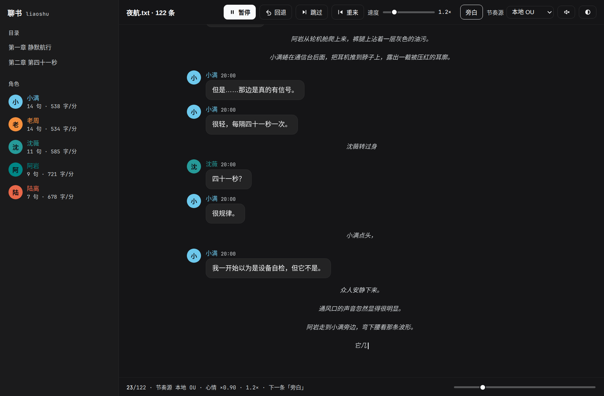

# 聊书 · liaoshu

导入一本 txt 电子书，程序切出**旁白**和**人物对话**，认出发言人，然后用群聊的样子
一条一条"打"出来 —— 有头像、有「正在输入…」、有打字节奏、有停顿、有音效。
随时可以**暂停、回退、跳转、改速度**。

界面直接沿用 DeepSeek 的设计令牌，明暗两套自动跟随系统。



<details>
<summary>亮色主题（同一套令牌的另一个分支）</summary>


</details>

---

## 跑起来

只依赖 Python 标准库，不需要 npm、不需要构建。

**要求**：Python 3.9+（开发环境 3.12）。`node` 只有跑音效测试时才用到。

```bash
cd liaoshu
python3 run.py samples/夜航.txt          # 自动开浏览器，监听 127.0.0.1:8770
python3 run.py 某本书.txt --speed 2.5
python3 run.py 某本书.txt --mood fly     # 用果蝇连接组当节奏的慢变量
python3 run.py 某本书.txt --ui native    # 原生窗口（需 pip install pywebview）
python3 run.py 某本书.txt --ui tk        # 退回零依赖的 tkinter 界面
python3 run.py --parse-only 某本书.txt    # 只看解析结果，不开界面
```

**原生窗口版**（想当"软件"而不是开浏览器）：
pywebview 把本地网页包成一个独立窗口，Linux 走 WebKitGTK、Windows 走
系统自带的 Edge WebView2；窗口关掉服务就停，不留后台。装法：

```bash
pip install pywebview              # 也可以 --user 装
python3 launcher.py --ui native    # 弹选书 → 原生窗口
# 或直接 python3 run.py 某本.txt --ui native
```

没装 pywebview 时 `--ui native` 会提示并自动退回系统浏览器。

**桌面一键启动**（Linux：双击图标、应用菜单、右键 txt → 打开方式）：

```bash
python3 tools/install_desktop.py            # 装到 ~/.local/share/，生成「聊书」图标
python3 tools/install_desktop.py --uninstall
```

装完后应用菜单搜「聊书」就能开；直接双击会弹系统选书窗口，选中一本才开始。
不想装桌面项，也可以 `python3 launcher.py 某本.txt` —— 和 `run.py` 唯一的区别是
**不给书时会弹选书对话框而不是报错**。

**Windows 打包成可执行文件**（不用装 Python、双击即用）：

```bat
:: 在 Windows 上：进项目目录，双击
packaging\build_windows.bat
:: 产物 dist\liaoshu.exe（无需装 Python；Win10/11 自带 WebView2 运行时）
```

一个 exe 双击 → 选书窗口 → 原生聊天窗口，没有控制台黑框。

为什么是"本地服务 + 浏览器"而不是桌面控件：DeepSeek 那套设计是**靠 CSS 变量驱动的**
（14 个 `--dsw-alias-*` 令牌，每个都要求明暗两套值），tkinter 消费不了。
换成网页之后，圆角、阴影、字体渲染、明暗切换、以及**用 Web Audio 合成音效**才都成立。
它仍然是一个跑在本机的独立程序，只是界面绘制交给了浏览器。

---

## 音效：会不会要一堆文件？

**不会。零个音频文件。**

打字声如果用"一个按键一个 wav"的思路做，既要塞几百个文件，听起来还是一样的——
因为真人敲键盘每次的力度和角度都不同。正确做法是**现场合成**：

```
一段 60ms 的白噪声（全程序只有这一块 buffer，约 5KB）
  → 随机带通滤波（1500–3700Hz）
  → 高通 700Hz
  → 1.5ms 起音 + 12–26ms 指数衰减的包络
  → 再叠一个 170Hz 往下扫到 70Hz 的三角波当"闷响"
```

每次敲击都随机化滤波频率、增益、衰减时长和音高，于是有了无穷多种"不同的敲击"，
而内存占用始终是那 5KB。

| 音效 | 做法 |
| --- | --- |
| 打字 | 上面那条链，**20ms 限流**（高速播放时不会变成机枪扫射） |
| 消息送达 | 880Hz + 1320Hz 两个正弦短音 |
| 新章节 | C-E-G 三个音的小琶音 |
| 开关反馈 | 点一下按钮就播一次打字声 |

实测（`node tests/test_sfx.js`，用一个假的 AudioContext 把整条音频图跑一遍）：
一次按键产生 `bufferSource ×1 + biquad ×2 + oscillator ×1 + gain ×2`；
连续 200 次点击只会调度 ≤3 个振荡器，限流确实生效。

> 音效默认是**关**的，因为浏览器不允许页面在用户交互之前出声。
> 点右上角那个喇叭才会启动 AudioContext，之后会记住你的选择（localStorage）。

---

## 操作

| 操作 | 快捷键 | 说明 |
| --- | --- | --- |
| 播放 / 暂停 | `空格` | 暂停是**原地冻结**，继续时接着打，不会整条重来 |
| 回退 | `←` | 正在打的那条 → 撤掉重打；已经打完的 → 退回上一条重打。连按可以一路退回 |
| 跳过 | `→` | 当前这条瞬间显示完 |
| 重来 | `R` | 回到第一条 |
| 任意跳转 | 底部进度条 / 左侧目录 | 点章节直接跳；拖动松手即跳，**瞬间**补出前面的内容再接着播 |
| 速度 | 工具条滑块 | 0.1×–6×，只影响还没打的部分，已显示的不动 |
| 旁白开关 | 按钮 | 关掉旁白后**阅读位置不丢**（见下方说明） |
| 节奏源 | 下拉菜单 | 本地 OU / 果蝇连接组 / 两者相乘，可随时热切换 |
| 明暗主题 | ◐ | 自动 → 深色 → 浅色 循环，结果记在 localStorage。也可以 `?theme=dark` 直接用链接指定 |

服务端还有一条体贴的逻辑：**没人看的时候不自己往前跑**。
第一个浏览器连上才开播，最后一个关掉就自动暂停；但"你自己按的暂停"会被尊重，
关掉页面回来不会莫名其妙继续播。

---

## 打字节奏是怎么做的

「真实感」不来自"随机数够不够随机"，而来自**结构**。独立同分布的随机延迟打出来像
均匀的雨点；真人打字是成串的。所以节奏分三层：

| 层 | 时间尺度 | 做什么 |
| --- | --- | --- |
| 角色基线 | — | 每个角色一个 `ms/字`，由他自己的台词统计推出来（话多、爱用感叹号的打得快；爱用省略号的犹犹豫豫） |
| 局部结构 | 单条消息内 | 词内连打变快（×0.42–0.72）、起新词和换词顿一下、标点后必然停顿（`，` 130ms、`。！？` 270–300ms）、偶尔卡壳 180–900ms |
| 快变量 | ~1 秒 | AR(1) 过程：同一个人一阵快一阵慢（"词组呼吸"） |
| 慢变量 | 10–120 秒 | 心情轨道，见 `mood.py` |

实测（示例书前 39 条消息，共 566 个逐字延迟）：
均值 71 ms/字，标准差 69 ms，**lag-1 自相关 +0.155** —— 相邻的延迟正相关，
字是"成串"出来的，不是独立抽的。

每个角色的手感确实不一样：

| 角色 | 台词条数 | ms/字 | ≈字/分 | 逐字抖动 | 抢话程度 |
| --- | --- | --- | --- | --- | --- |
| 沈薇 | 11 | 102 | 585 | 0.40 | 1.39 |
| 阿岩 | 9 | 83 | 721 | 0.49 | 1.24 |
| 老周 | 14 | 112 | 534 | 0.42 | 0.78 |
| 小满 | 14 | 112 | 538 | 0.50 | 0.80 |
| 陆离 | 7 | 88 | 678 | 0.45 | 1.42 |

而且**整个时序是确定性的**：第 N 条消息的每一拍延迟只由 `(N, 角色, 文本)` 决定，
和"现在播到哪儿"无关。所以「回退」就是把缓存丢到该处重算，得到一模一样的结果，
不需要为撤销写任何补偿逻辑。这也是为什么回退可以连按、可以跳到任意位置。

> ⚠️ **关于"真实"要说清楚**：默认速度对真人来说是**压缩过约 10 倍**的
> （102 ms/字 ≈ 585 字/分）。不压缩的话读一本书要等到天荒地老。
> 所以默认速度下真实的是**节奏结构**（相对快慢、成串、标点停顿），不是绝对速度。
> 想看真人速度就把滑块拖到 **0.1×**（1020 ms/字 ≈ 59 字/分，正好是真人打中文的水平）。

---

## 解析器：怎么切旁白和对话

`liaoshu/parser.py`。中文 txt 的实际情况比想象中脏，处理了这些：

- **引号**：`「」『』“”` 和 ASCII `"`；支持**跨段未闭合**的长对白
  （`“前半句……` / `“后半句。”` 会合并成同一条）
- **硬换行**：按固定列宽断行的 txt（每行 40/76 字且大多数行不以句末标点结尾）
  会被识别并接回去
- **说话人判定分两遍**：第一遍只用**紧贴引号、两端锚定**的「名字+言语动词」建演员表；
  第二遍拿演员表解析模糊的（代词、上下文提到的人、纯轮替）
- **聊天记录体**：整篇都是 `名字：内容` 的（不带引号），只要占比 ≥50% 就按它解析

### 一个踩过的坑，值得写下来

第一版用「整段扫 名字+动词」的松匹配，结果出现了一个角色叫 **「他说」**：

```
说话人: [('沈薇', 19), ('??', 18), ('他说', 18)]
```

原因是中文里 `道/想/念/应` 这些单字动词满地都是（知道、想到、应该），
松匹配会把 `他压低声音，“你之前说` 里的 `他压` 凑成一个人名。

修法是让匹配**锚定在引号旁边**，并且名字和动词之间不允许跨句末标点和引号：

```python
_MID = r"[^。！？\n“”「」『』\"]"
_AFTER_LOOSE_RE = re.compile(rf"^(?P<name>{_NAME}){_MID}{{1,12}}?(?P<v>{_VERB_ALT})")
```

另外，纯署名的旁白片段（`他说，`）会被丢掉，不然聊天流里会刷一堆"他说，"。

### 实测准确率（示例书《夜航》，55 条对话）

| 判定方式 | 数量 | 说明 |
| --- | --- | --- |
| 显式署名（引号旁） | 20 | `“……”沈薇说。` / `沈薇说：“……”` |
| 上下文提到 | 18 | `“……”沈薇的声音从驾驶席传来。` |
| 纯轮替猜测 | 17 | 无任何线索，按"两个人你一句我一句"轮替 |

界面上，纯猜测的名字后面会标一个「推断」，上下文提到的算高置信、不标。

### 自己动过滤：规则文件

解析器内置了一张「名尾功能字」黑名单，专治 `德顺老汉唱完`、`加林开玩` 这类被贪婪
吃进去的假名。但每本书的坑不一样，与其等改代码，不如给用户一条自己的路：

```bash
python3 run.py --rules-init          # 生成一份示例规则，改完重开一次就生效
```

文件在 `~/.config/liaoshu/rules.json`（Windows 是
`%LOCALAPPDATA%\liaoshu\rules.json`），三个开关：

```json
{
  "ban":     ["身子往儿"],        // 整词匹配，这些词永远不当说话人
  "letters": ["儿", "珠"],         // 名尾黑名单：末字是这些的都别当说话人
  "map":     {"高加林": "加林"}     // 改名 / 多别名并成一个人
}
```

`letters` 是「按这本书调」的：`儿` 在《人生》里几乎全是语尾（`身子往儿＝身子往儿子…`），
换一本书可能就是真名（栓儿、巧儿）。所以内置表里不放它，交给你按书决定。
`--rules 别的.json` 可以指定另一份规则；命令行和原生窗口自动读默认那份。

> 上一版「她说」被忽略、纯靠轮替瞎猜，错了一大批有署名的人名
> （其中 8 条把「她」给了男角色）。现在单字代词也能当署名，
> 指代会落到"旁白里刚点名的人"身上，那批猜错的名字基本都回正了。

---

## 关于 flybrain：结论

你问「借助 flybrain 来做对话的打字间隔随机，还是用单独的随机数就好」。
我把它真的接进去跑通了，然后实测了一遍 —— **答案是单独的随机数（但必须带自相关）**。

| 500ms 窗口的信号 | CV | lag-1 自相关 |
| --- | --- | --- |
| 果蝇总放电 | 7.49% | **−0.046** |
| 果蝇下行神经元 L/R | ~10.7% | **+0.052 / −0.117** |
| 本地 12 行 OU 过程（对照） | 4.0 | **0.979**（10 秒后还有 0.617） |

flybrain 的起伏**有幅度但没有记忆**——是白噪声。而打字节奏真正需要的是记忆：
心情要能持续几十秒。逐字尺度更用不上，它步长 20ms，而逐字间隔在 30–300ms。

（顺带实测到两个有用的数字：`step()` 稳态 **7.96ms/步**，有 2.5× 实时余量；
并且 **step() 期间会释放 GIL**，所以果蝇可以安心跑在后台线程里，不会卡界面。）

三条路径都实现了，工具条「节奏源」可以随时热切换。切到果蝇后状态栏会一直显示
它**自己的实测统计量**（`CV 2.75% · 自相关 -0.054`）——这不是装饰，
是让"这条轨道到底有多少信息"一直摆在眼前，省得自己骗自己。

完整实验记录和复现命令见 **[docs/flybrain-rhythm-experiment.md](docs/flybrain-rhythm-experiment.md)**。

---

## 目录结构

```
liaoshu/
├── run.py                      入口（argparse）
├── launcher.py                 桌面启动器：不给书就弹系统选书窗口
├── liaoshu/
│   ├── parser.py               txt → 旁白/对话/说话人（两遍解析）
│   ├── rules.py                用户过滤规则（ban/letters/map，见上文）
│   ├── personas.py             角色 → 打字手感（颜色、头像、ms/字、抖动）
│   ├── rhythm.py               三层节奏模型 + 确定性播放器
│   ├── mood.py                 慢变量：本地 OU / flybrain 轨道 / 两者相乘
│   ├── server.py               本地 HTTP + SSE（标准库，无第三方依赖）
│   ├── desktop.py              pywebview 原生窗口（--ui native）
│   ├── web/
│   │   ├── index.html          界面骨架（--BOOT-- 处嵌入首屏快照）
│   │   ├── style.css           DeepSeek 设计令牌 + 布局
│   │   └── app.js              SSE 客户端、渲染、Web Audio 音效
│   └── ui.py                   旧 tkinter 界面（--ui tk，保留作无浏览器时的退路）
├── packaging/
│   ├── liaoshu.spec            PyInstaller 打包配置（console=False）
│   └── build_windows.bat       Windows 一键打包成 dist\liaoshu.exe
├── tools/
│   ├── install_desktop.py      装/卸 ~/.local/share/applications/liaoshu.desktop
│   ├── liaoshu.svg             应用图标
│   └── fly_mood.py             跑果蝇大脑生成"心情轨道"（子进程，可缓存）
├── experiments/flybrain_slowvar.py   测 flybrain 信号质量（CV / 自相关 / GIL）
├── tests/
│   ├── test_liaoshu.py        解析 + 时序确定性 + 回退/跳转（无需界面）
│   ├── test_ui.py              tkinter 界面层
│   └── test_sfx.js             音效合成（假 AudioContext 跑整条音频图）
├── samples/夜航.txt            示例书（原创）
└── cache/fly_mood.txt          flybrain 心情轨道缓存（已生成好）
```

```bash
python3 tests/test_liaoshu.py        # 解析 + 时序确定性 + 回退/跳转（无需界面）
python3 tests/test_ui.py             # tkinter 界面层（没有显示器会自动跳过）
node tests/test_sfx.js               # 音效合成（用假 AudioContext 跑整条音频图）
```

---

## 配色是从哪来的

不是我自己调的。`liaoshu/web/style.css` 顶部那 14 个 `--dsw-alias-*` 色值，
是从本机装着的 DeepSeek 客户端主题包里解出来的**最终值**（`body{}` 是亮色，
`body[data-ds-dark-theme]{}` 是暗色，令牌之间还有一层 `--dsw-static-*` 间接引用，
写了个小解析器把它们递归展开）。圆角 4/8/12/16/20/28 和字体栈也一并取用。

好处是：观感和 Harness 一致，而且它本来就要求明暗两套，所以**换主题不用另调色**。
坏处是：这些都还是硬编码的副本，DeepSeek 改了令牌不会自动跟过来。
真要做到自动跟随，得把它做成 DSH 客户端插件，直接消费 CSS 变量——
那就只能在 Harness 里跑，不再是独立软件了。这是个取舍，我选了独立。

---

## 几个实现上的取舍

**为什么用 SSE 而不是 WebSocket。** SSE 是单向推流，`http.server` 标准库就能做，
不需要任何第三方依赖。命令走 POST、事件走 SSE，一共两个端点。

**首屏快照直接嵌在 HTML 里。** 服务端读到 `index.html` 后把当前状态塞进
`window.__BOOT__`，页面不用等异步请求就能画出内容，省掉一次白屏闪。
（附带好处：无头浏览器截图变得可行——`--virtual-time-budget` 会等网络空闲，
而 SSE 永远不空闲。）

**为什么旁白开关不重新解析。** 播放器有一个 `skip_predicate`：被跳过的消息
不渲染也不占时间，但**仍然占一个下标**。所以开关旁白时阅读位置天然不变。

**为什么消息流只保留最近 260 条。** 长篇小说全渲染会吃光内存。更早的节点
会被移除，但播放器状态完整，往回跳会重新渲染。

**为什么回退语义是"两条分支"。** 用户按回退时想要的是"撤销我看到的东西"：
正在打的那条 → 撤掉它、从开头重打；否则 → 退回上一条。这样连按可以一路退回开头。

---

## 已知限制

- **解析器是启发式的**，没有 NLP 模型。示例书上 55 条对话里 17 条是纯轮替猜的；
  换一本书（尤其多人对话、大量无署名对白）准确率会变。界面上标「推断」的就是猜的。
- **名字的边界靠"末字黑名单"拦**：中文名字不会用动词/副词/称谓收尾，
  parser 会拒绝 `气冲冲地`、`高玉德犹`、`她问儿子` 这类被贪婪名字吃出来的假名
  （`liaoshu/parser.py` 的 `_BAD_NAME_TAILS`）。代价是个别以 `张/老/鲁` 收尾的
  昵称型称呼（如 `老张`、`黄老`）会让位于更常见的 `父亲紧张` 型误判，属于取舍。
- **配色令牌是硬编码副本**，不会跟随 DeepSeek 的更新（见上一节）。
- **默认速度是压缩过的**（约 10×）。真实的是节奏结构，不是绝对速度。
- **没有并发打字**。真实群聊会有两个人同时"正在输入"。当前一次一条，
  这是为了让回退/跳转的语义保持干净。要加的话调度器改成小顶堆就行，
  但"回退到 3 分钟前"会变得很麻烦。
- **没有做拼音输入法模拟**。真实中文输入是"敲拼音→选字"，所以节奏是词组级的；
  现在的模型用"词内连打变快 + 换词顿一下"近似它，没有真的打拼音再替换。
- **音效是合成的**，不是真人录音。合成的好处是零文件、可随节奏实时变化，
  代价是它听起来像"很好的机械键盘"，而不是"某个具体的人"。

---

## 许可

[MIT](LICENSE)。`samples/夜航.txt` 是本仓库作者写的原创短篇，也一并按 MIT 提供。

界面配色取自本机安装的 DeepSeek 客户端主题令牌（色值属于事实性数据），
本项目与 DeepSeek 官方无隶属关系。

`cache/fly_mood.txt` 是用 [flybrain](https://pypi.org/project/flybrain/)
（MaleCNS 果蝇连接组）生成的心情轨道缓存，只有 5KB，
提交进来是为了让 `--mood fly` 开箱即用、不必先等两分钟。它完全可以删掉重新生成。

